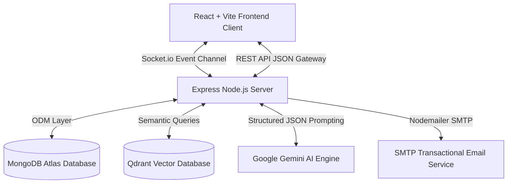
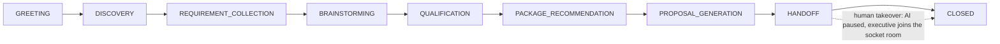

# AI Sales Executive Platform (ASEP)

[](https://github.com/dgexplores/smart-chatbot/actions) [](https://github.com/dgexplores/smart-chatbot/actions)

An industry-grade, autonomous pre-sales qualification agent and real-time CRM monitoring platform designed for Indian IT consultancy markets.

This platform uses an event-driven web-sockets architecture, a custom state-machine orchestrator powered by the Gemini Flash Lite SDK, semantic RAG vector querying, and custom transactional mail dispatches to qualify leads, automate proposals, and schedule callbacks dynamically.

## 🎬 Demo video — what ASEP is & how to use it

<video src="https://raw.githubusercontent.com/dgexplores/smart-chatbot/main/docs/demo_asep.mp4" controls muted autoplay loop playsinline></video>

*Direct link: [docs/demo_asep.mp4](docs/demo_asep.mp4)* — recorded screen capture of the real deployed client (UI-only mode; see the confidential note below for why live AI responses are not shown here).

**Timeline of the video (captions are on-screen):**

| Caption | What you are seeing |
|---|---|
| ASEP — AI Sales Executive Platform | Landing hero: *"One Stop Solution For All Your Tech Company Needs"* + primary CTA |
| 01 · The journey | Product story — **Understand → Organize → Connect** |
| 02 · Assistant handles discovery | *"A smart assistant that keeps your people in control"* — Start with the goal → Shape the brief → Move forward together |
| 03 · Helpful automation, human relationships | Context never disappears — your workflow stays yours |
| 04 · One conversation → qualified brief | The enquiry-to-brief value path |
| 05–06 · Chat companion | The slide-up AI Sales Assistant opens with suggestion pills (**Need website · Cost estimates · Book meeting**) and a visitor types a requirement |

**How a visitor uses it (live demo):**
1. Open [https://client-blue-nu-26.vercel.app](https://client-blue-nu-26.vercel.app).
2. Click the floating chat button (or **Talk to ASEP** / **Start a conversation**).
3. Pick a suggestion pill or type a requirement — the assistant structures it in conversation. *(Live AI responses require the backend; the public instance intentionally runs UI-only — see `VITE_API_URL` in Live Demo.)*
4. In production, a qualified chat turns into a structured brief that an **executive workspace** picks up for negotiation and handoff.

## Live Demo

The redesigned client is deployed on Vercel: [https://client-blue-nu-26.vercel.app](https://client-blue-nu-26.vercel.app)

> The public demo runs without a backend by default. Set `VITE_API_URL` to a deployed API URL to enable live Socket.io conversations, lead qualification, and executive handoff.

---

## 🛠️ Tech Stack & Architecture



### 🔁 Conversation State Machine (the pre-sales spine)



Each transition fires only when the orchestrator qualifies the required parameters (BANT-style: budget, need, timeline, authority). Mid-flow, **HANDOFF** pauses AI replies over Socket.io and hands the room to a human executive — the visitor sees one continuous conversation.

### 1. Backend Architecture (Express + TypeScript)
* **Design Pattern: State Machine Orchestrator**
  * The pre-sales conversations follow a state pattern: `GREETING` ➔ `DISCOVERY` ➔ `REQUIREMENT_COLLECTION` ➔ `BRAINSTORMING` ➔ `QUALIFICATION` ➔ `PACKAGE_RECOMMENDATION` ➔ `PROPOSAL_GENERATION` ➔ `HANDOFF` ➔ `CLOSED`.
  * The orchestrator dynamically moves stages as BANT parameters are qualified.
* **Design Pattern: Event Broker Pattern (Sockets)**
  * Uses Socket.io to stream real-time updates (typing indicators, chat takeover signals, notification alerts) across rooms.
* **Design Pattern: Repository Pattern (Mongoose ODM)**
  * Interfaces with Mongoose schemas (`Lead`, `Conversation`, `Message`, `Proposal`, `Meeting`) to ensure transactional consistency across documents.

### 2. Frontend Architecture (React + Vite + Tailwind CSS)
* **Single Page Dashboard & Client Widgets:**
  * **Visitor Chat Widget:** Responsive slide-up drawer showing bot status, interactive suggestion pills, typing dots, and downloadable PDF cards.
  * **Executive CRM Workspace:** A split-screen dashboard displaying a qualified leads pipeline, a live takeover chat console, and a CRM panel with dial/email shortcuts, callback timers, and quick notes.

---

## 💎 Advanced Real-World Features

### 1. 🇮🇳 Local Market Competitive Pricing
* Computes real-time project estimates in Indian Rupees (INR - ₹) based on competitive local consultancy scales.
* Standardized pricing rules:
  * **Web Designing & Development:** Basic Showcase sites range from ₹25,000 to ₹50,000. Professional dynamic apps range from ₹1 Lakh to ₹2.5 Lakhs. Custom SaaS apps range from ₹3 Lakhs to ₹8 Lakhs+.
  * **UI/UX Designing:** Figma wireframes and branding prototypes range from ₹25,000 to ₹1 Lakh.
  * **Mobile Applications:** iOS & Android apps (Flutter/React Native) range from ₹3.5 Lakhs to ₹10 Lakhs.
  * **SEO:** Ranking, backlinks, page-speed check: ₹15,000 to ₹40,000/month.
  * **Content Writing:** High-quality SEO copywriting: ₹10,000 to ₹25,000/month.
  * **Digital Marketing & PPC Ads Shield:** Campaign setup & ad fraud fraud-prevention block shield: ₹25,000 to ₹60,000/month.

### 📅 2. Natural Language Scheduling (NLP Date Parser)
* The agent asks the client for their preferred callback date and time.
* The parser converts natural descriptions (e.g. *"tomorrow at 5 PM"*, *"afternoon"*, *"Monday morning"*) into exact UTC database timestamps.

### 📧 3. Deferred Transactional Emailing
* If the user shares their email address *after* a callback has been scheduled, the backend captures the save event and dispatches the tailored project brief (including their timeline, budget, features, and Meet link) directly to their inbox.

### 💹 4. Adaptive Market Pricing
* Pricing lives as **versioned data**, not code: a `PricingConfig` rate card that the AI reads fresh on every conversation, so quotes always use the *current* ranges.
* A daily background job re-tunes each service's price multiplier within a bounded corridor (±30% by default) based on:
  * **Win/loss feedback** — proposal outcomes recorded via `PATCH /api/v1/proposals/:id/status` (win rate > 60% nudges prices up, < 35% nudges them down, minimum 5 samples per service).
  * **Competitor position** — `CompetitorPrice` records; prices ease down when we sit well above the market median and may rise when below.
  * **Demand trend** — qualified-lead volume over the last 7 days vs. the previous 7.
* Every proposal records which pricing version generated it (`pricingVersion` + matched `services`) so the feedback loop can attribute outcomes to price points. Stale SENT proposals auto-expire after 30 days.
* **Updating over time:** the job runs at boot and then every `PRICING_REFRESH_HOURS` (default 24h). Record competitor observations via `POST /api/v1/competitors` (`{ service, competitor, price }`), inspect the live rate card via `GET /api/v1/pricing/rates`, and trigger an immediate re-tune via `POST /api/v1/pricing/recompute`. Proposal decisions (`PATCH /api/v1/proposals/:id/status`) also trigger a recompute on the spot.
* **Automatic market capture:** a market scanner periodically fetches configured competitor pricing pages (`MarketTarget` records, managed via `/api/v1/market-targets`) and extracts INR rates — JSON-LD structured data first, plain `₹` amounts as fallback. Observations land in `CompetitorPrice` and feed the next re-tune. Run it on demand with `POST /api/v1/market-targets/scan`; the check interval is `MARKET_SCAN_HOURS` (default 24h) and each target has its own refresh window (`intervalHours`, default weekly).

---

## 🧭 Capabilities — as of now

| Area | Status |
|---|---|
| Real-time visitor chat (slide-up widget, suggestion pills, typing indicators) | ✅ in code, runs in the public demo |
| 9-state qualification orchestrator (BANT-driven transitions) | ✅ in code — needs backend to run live |
| Human takeover + Executive CRM workspace (pipeline, takeover console, callback timers) | ✅ in code — needs backend + JWT |
| RAG grounding (chunked docs → embeddings → Qdrant search → retrieved context) | ✅ in code — falls back to built-in chunks without Qdrant |
| Adaptive market pricing (versioned `PricingConfig` rate card, ±30% corridor, daily re-tune) | ✅ in code with server tests |
| Market scanner (competition INR rate capture from configured pages) | ✅ in code |
| Natural-language callback scheduling ("tomorrow at 5 PM" → UTC) | ✅ in code |
| PDF proposals + deferred transactional email | ✅ in code — needs SMTP service |
| Security (JWT roles, Helmet, rate limiting) | ✅ server-side |
| Demo data seeding (10 leads, proposals w/ outcomes, meetings, 8 weeks competitor data) | ✅ `SEED_DEMO_DATA=true` |
| **Live public deployment** | ✅ **UI-only** — the deployed backend, keys and live AI responses are kept confidential (below) |

**Status, honestly:** this is a **functional prototype**. Architecture and workflow are proven (and tested server-side); full production operation needs configured external services — Gemini API key, MongoDB, Qdrant, SMTP, auth deployment — exactly as listed in the deployment sections below.

## 🚀 Easy Local Setup

We have included an automated setup utility script to prepare your workspace in seconds.

### Prerequisites
* **Node.js:** v18+
* **npm:** v9+
* **MongoDB:** Atlas cloud connection string or local running instance.

### Setup Instructions
1. Clone this repository to your local directory.
2. Grant execution permissions and run the setup script:
   ```bash
   chmod +x setup.sh
   ./setup.sh
   ```
   *This script will verify prerequisites, copy `.env.example` templates, install dependency trees, and pre-compile the server and client builds.*
3. Open `server/.env` and update your `MONGO_URI`, `GEMINI_API_KEY`, and `JWT_SECRET` (the server refuses to boot with the placeholder secret). For production, also set `PUBLIC_BASE_URL` to your deployed API URL so proposal PDF links work.
4. Launch the application:
   * **Start Backend API:** `cd server && npm run start`
   * **Start Client Dev:** `cd client && npm run dev`
5. Open **http://localhost:5173** to interact with the platform!

## ☁️ Deployment (free tier, judge-demo ready)

The recommended free setup keeps the whole product alive reliably: **Vercel** for the
client, **Koyeb** for the long-running server (WebSockets + scheduled pricing/market
jobs need a real process, not serverless), and **MongoDB Atlas** free tier for data.
Qdrant is optional — the RAG layer falls back to built-in chunks when it is offline.

### 1. Server → Koyeb (`koyeb.yaml` at repo root)
1. Sign up at koyeb.com (GitHub login works).
2. Import the repo **dgexplores/smart-chatbot** → it picks up `koyeb.yaml`
   (builds `server/Dockerfile`, runs on port 5001, health-checked at `/health`).
3. Set service variables (secrets are never committed):
   - `JWT_SECRET` (required — generate with `openssl rand -hex 32`)
   - `MONGO_URI` from your Atlas cluster
   - `PUBLIC_BASE_URL` = the Koyeb service URL (makes proposal PDF links work)
   - `CLIENT_URL` = the Vercel URL below (CORS)
   - `MOCK_LLM=false` + `GEMINI_API_KEY` for real AI (free key at aistudio.google.com)
4. `SEED_DEMO_DATA=true` is set in `koyeb.yaml` — on first boot it seeds 10 realistic
   leads, conversations, proposals (with win/loss outcomes), meetings, and 8 weeks of
   competitor market observations so the dashboard looks alive for a showcase.

### 2. Client → Vercel
1. `vercel login`, then from `client/`: `vercel --prod` (uses `client/vercel.json`).
2. Set `VITE_API_URL` to the Koyeb service URL in the project settings and rebuild.

### 3. Verify
- `GET https://<server>/health` → `{ status: 'ok' }`
- `GET https://<server>/api/v1/pricing/rates` → live rate card with multipliers
- Open the Vercel URL → chat widget talks to the real backend via WebSockets.

### Alternative hosts
- **Railway** (`scripts/deploy-railway.sh` — one-command deploy): note the free plan
  can hit the resource-provision limit; Hobby ($5/mo) is required for more services.
- **Docker anywhere**: `server/Dockerfile` builds the API for any container host.
- **Render/Fly**: same Dockerfile; expect free-tier sleep/cold-start behaviour.

---

## 🔒 Confidentiality note

The **full production deployment of this platform is protected and confidential to the company**. The publicly launched instance is intentionally **UI-only** — the live backend, API keys, customer records, vector database contents and server configuration are not and will not be published. This repository contains the **showcase portion** built during the internship: the client, the server architecture, the agent logic, tests and the demo configuration. To evaluate the whole product live, deploy it yourself per the deployment guide above (free tier, ~30 minutes).

## 🙋 FAQ — questions the presentation panel may ask

**Q. Did you build this entirely yourself?**
> During the internship I studied and documented the architecture, conversation flow and interface, and worked on refinement around it. The platform was at prototype stage then; this repository now presents the fuller system. What I can fully explain and demonstrate is its design: the 9-state workflow, the client–server split, RAG grounding and the human handoff.

**Q. What is RAG doing here — why not just ask the model directly?**
> Direct model answers are generic. RAG retrieves project knowledge — docs are chunked, embedded, and searched in Qdrant — and feeds the retrieved context to Gemini, so answers come from approved company knowledge. Without Qdrant, the system falls back to built-in chunks.

**Q. How does the executive takeover work?**
> Socket.io rooms broadcast a takeover signal: AI replies pause, the executive joins the same conversation with full context (messages, brief, pricing), and can release the chat back to the AI afterwards.

**Q. Is adaptive pricing real logic or a mock?**
> Real logic with a bounded feedback loop: win/loss proposal outcomes, competitor observations and 7-day demand re-tune a versioned rate card every 24h within ±30%. Every proposal records the pricing version used, so outcomes attribute to price points. Server tests cover the orchestrator stages, pricing and an end-to-end flow.

**Q. Is there any real customer data in this repo?**
> No. `SEED_DEMO_DATA=true` seeds fabricated leads, conversations, proposals and market observations so the dashboard looks alive for evaluation. Production data stays on the confidential deployment.

**Q. How would you take this from prototype to production?**
> Deploy the server (Koyeb/Docker) with the configured services — Gemini key, MongoDB, Qdrant, SMTP, JWT secrets — connect `VITE_API_URL`, and monitor conversation quality. The deployment section above documents the exact steps.

**Q. Why Gemini Flash Lite?**
> It supports the structured-JSON prompting the orchestrator depends on for deterministic stage transitions, at a cost tier that suits continuous pre-sales conversation — with a `MOCK_LLM` fallback for offline development.
